# ambientCG: Fabric materials

**28 assets from [ambientCG](https://ambientcg.com), dedicated to the public domain under [CC0](https://docs.ambientcg.com/license/).** Use them in any game, free or paid, and change them however you like; no credit is needed.

PBR materials as 1K and 2K JPG maps (colour, normal GL and DX, roughness, AO, displacement), one folder per resolution. 898.0 MB in all.

This is a copy kept by [zuujis-cc0](https://github.com/zuujis-cc0) so game makers can take single files from GitHub. It is not made by or affiliated with ambientCG: the originals, often in more formats and higher resolutions, are on [ambientcg.com](https://ambientcg.com). If they help you, consider [supporting ambientCG](https://www.patreon.com/ambientCG).

Every file is listed in [MANIFEST.tsv](MANIFEST.tsv) with its size and SHA-256. More free assets: [the Zuujis collection](https://github.com/zuujis-cc0/free-game-assets#readme).

| | | | |
| :-: | :-: | :-: | :-: |
| <a href="Fabric001">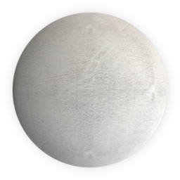</a> <b><a href="Fabric001">Fabric 001</a></b> by ambientCG · <a href="https://ambientcg.com/a/Fabric001">source</a> | <a href="Fabric002">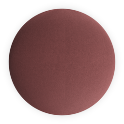</a> <b><a href="Fabric002">Fabric 002</a></b> by ambientCG · <a href="https://ambientcg.com/a/Fabric002">source</a> | <a href="Fabric003">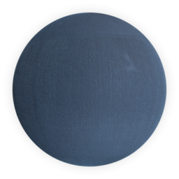</a> <b><a href="Fabric003">Fabric 003</a></b> by ambientCG · <a href="https://ambientcg.com/a/Fabric003">source</a> | <a href="Fabric004">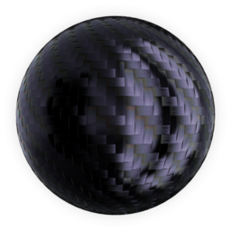</a> <b><a href="Fabric004">Fabric 004</a></b> by ambientCG · <a href="https://ambientcg.com/a/Fabric004">source</a> |
| <a href="Fabric005">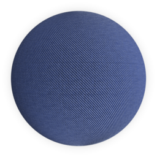</a> <b><a href="Fabric005">Fabric 005</a></b> by ambientCG · <a href="https://ambientcg.com/a/Fabric005">source</a> | <a href="Fabric006">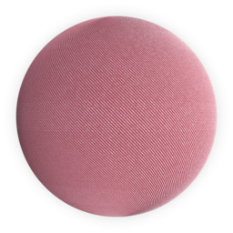</a> <b><a href="Fabric006">Fabric 006</a></b> by ambientCG · <a href="https://ambientcg.com/a/Fabric006">source</a> | <a href="Fabric007">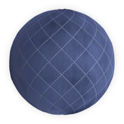</a> <b><a href="Fabric007">Fabric 007</a></b> by ambientCG · <a href="https://ambientcg.com/a/Fabric007">source</a> |  <b><a href="Fabric008">Fabric 008</a></b> by ambientCG · <a href="https://ambientcg.com/a/Fabric008">source</a> |
| <a href="Fabric009">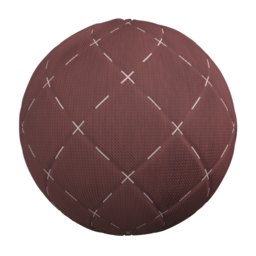</a> <b><a href="Fabric009">Fabric 009</a></b> by ambientCG · <a href="https://ambientcg.com/a/Fabric009">source</a> | <a href="Fabric010">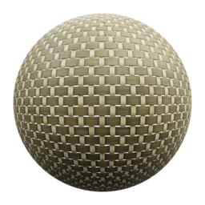</a> <b><a href="Fabric010">Fabric 010</a></b> by ambientCG · <a href="https://ambientcg.com/a/Fabric010">source</a> | <a href="Fabric011">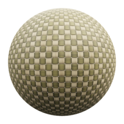</a> <b><a href="Fabric011">Fabric 011</a></b> by ambientCG · <a href="https://ambientcg.com/a/Fabric011">source</a> | <a href="Fabric012">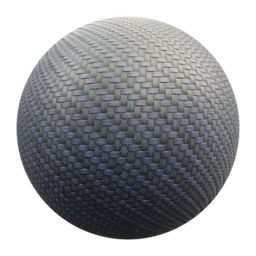</a> <b><a href="Fabric012">Fabric 012</a></b> by ambientCG · <a href="https://ambientcg.com/a/Fabric012">source</a> |
| <a href="Fabric013">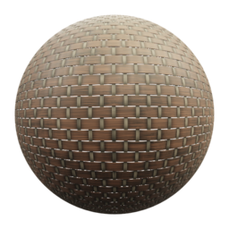</a> <b><a href="Fabric013">Fabric 013</a></b> by ambientCG · <a href="https://ambientcg.com/a/Fabric013">source</a> | <a href="Fabric014">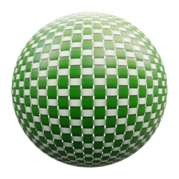</a> <b><a href="Fabric014">Fabric 014</a></b> by ambientCG · <a href="https://ambientcg.com/a/Fabric014">source</a> | <a href="Fabric015">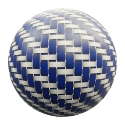</a> <b><a href="Fabric015">Fabric 015</a></b> by ambientCG · <a href="https://ambientcg.com/a/Fabric015">source</a> | <a href="Fabric016">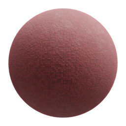</a> <b><a href="Fabric016">Fabric 016</a></b> by ambientCG · <a href="https://ambientcg.com/a/Fabric016">source</a> |
| <a href="Fabric017">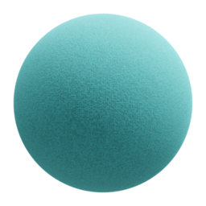</a> <b><a href="Fabric017">Fabric 017</a></b> by ambientCG · <a href="https://ambientcg.com/a/Fabric017">source</a> | <a href="Fabric018">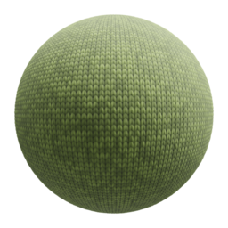</a> <b><a href="Fabric018">Fabric 018</a></b> by ambientCG · <a href="https://ambientcg.com/a/Fabric018">source</a> | <a href="Fabric019">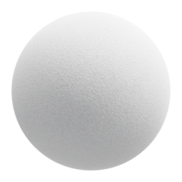</a> <b><a href="Fabric019">Fabric 019</a></b> by ambientCG · <a href="https://ambientcg.com/a/Fabric019">source</a> | <a href="Fabric020">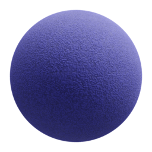</a> <b><a href="Fabric020">Fabric 020</a></b> by ambientCG · <a href="https://ambientcg.com/a/Fabric020">source</a> |
| <a href="Fabric021">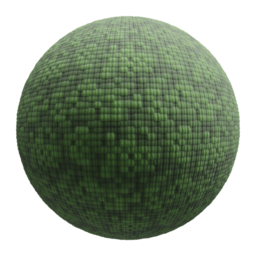</a> <b><a href="Fabric021">Fabric 021</a></b> by ambientCG · <a href="https://ambientcg.com/a/Fabric021">source</a> | <a href="Fabric022">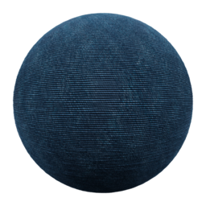</a> <b><a href="Fabric022">Fabric 022</a></b> by ambientCG · <a href="https://ambientcg.com/a/Fabric022">source</a> | <a href="Fabric023">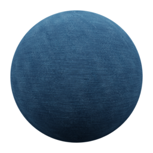</a> <b><a href="Fabric023">Fabric 023</a></b> by ambientCG · <a href="https://ambientcg.com/a/Fabric023">source</a> | <a href="Fabric024">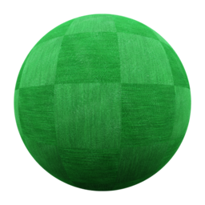</a> <b><a href="Fabric024">Fabric 024</a></b> by ambientCG · <a href="https://ambientcg.com/a/Fabric024">source</a> |
| <a href="Fabric025">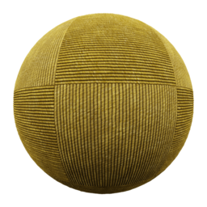</a> <b><a href="Fabric025">Fabric 025</a></b> by ambientCG · <a href="https://ambientcg.com/a/Fabric025">source</a> | <a href="Fabric026">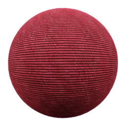</a> <b><a href="Fabric026">Fabric 026</a></b> by ambientCG · <a href="https://ambientcg.com/a/Fabric026">source</a> | <a href="Fabric027">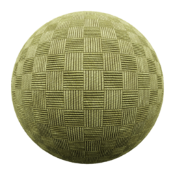</a> <b><a href="Fabric027">Fabric 027</a></b> by ambientCG · <a href="https://ambientcg.com/a/Fabric027">source</a> | <a href="Fabric028">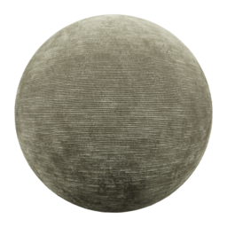</a> <b><a href="Fabric028">Fabric 028</a></b> by ambientCG · <a href="https://ambientcg.com/a/Fabric028">source</a> |

---

Kept up to date by this repository's own [update workflow](.github/workflows/update.yml), with code and plan from [cc0-mirror](https://github.com/zuujis-cc0/cc0-mirror). Something wrong? [Open an issue there](https://github.com/zuujis-cc0/cc0-mirror/issues/new) or use the [private report form](https://games.zuujis.com/report).
